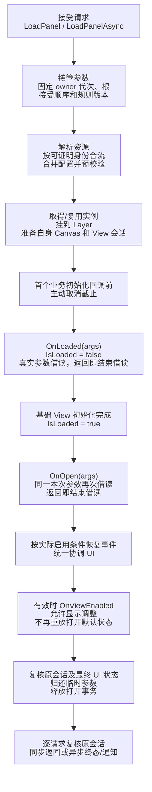

# YL UI Panel 重构实施计划

状态：2026-10-19 原任务 1～6 与九项增量核查的源码、测试和文档补齐及可执行离线验证已完成。依据直接用户授权继续最小补齐，覆盖本文原先“本轮不实施”和因缺少 Editor 证据停止后续源码迁移的等待条件；不降低任何运行契约。仅在 fusion/ui-panel-redesign worktree 工作，未调用 MCP、未启动 Unity、未同步主工程、未修改共享缓存/依赖/设置，未暂存/提交/合并。Unity 输入、生命周期、资产和 IL2CPP 关口均待集成后执行，离线检查不标为引擎通过。

**目标：** 以一套 Module/Panel/View 管线提供简洁、配置驱动的独立界面能力，同时让轻量默认使用与完整预配置使用都低接线成本。
**架构：** Module 是唯一业务 owner，Panel 继承 View 并复用会话、Model、事件和释放；现有 PanelManager 协调请求与 UI 策略，UIRootContext 仅承载根配置。资源沿当前 Core provider/lease 边界，输入在既有桥接中隔离业务状态，不另建资源后端、UI 对象池或全局输入系统。
**技术基线：** ProjectVersion 为 Unity 2022.3.62f3c1；输入方案研究依据 UGUI 1.0.0、Input System 1.14.0 源码，不等于本轮核实了活跃 Editor 的加载版本。manifest/lock 仍声明 UGUI 2.0.0、URP 16.0.6，lock 中 Input System 为 1.14.0；实施前读取实际加载版本，不在本任务修包配置。Foundation/Core/Utilities/Systems 是源码分区，不是不同 DLL。当前 YLFramework.Runtime.asmdef 引用 UnityEngine.UI，预编译引用 Newtonsoft.Json.dll、BouncyCastle.Cryptography.dll，不恢复旧 XF 依赖或删除现有资源系统依赖。
**执行：** 切换至有源码修改权限的代理后使用 `executing-plans` 按任务实施；本文件同时包含已确认契约、API 落点和验收标准，是本轮唯一实施依据。与历史 UI/结构计划或尚未迁移的使用文档冲突处以本文为准，不恢复旧 XFAB、窗口目录或 UIType 设计；普通 Core/Foundation 的既有有效契约仍保留，不另建重复设计文档。
**路径：** 下文 `Runtime/`、`Editor/`、`Tests/`、`Prefabs/`、`Documentation/` 均相对 `Assets/YLFramework/`；`.kilo/`、`Tools/`、`Packages/`、`ProjectSettings/` 相对仓库根。

## 全局约束

### 2026-10-19 增量核查检查点

- 授权与隔离：直接用户确认采用九项增量清单，原 Editor/MCP 禁令继续有效；不恢复错误模型任务，不创建可见会话/worktree/分支，不提交/推送/合并/Apply。前两条 peer 消息未产生修改；本轮从 HEAD `7b7107f`、原先全部未提交实施成果继续，无新增提交或暂存，保护已有差异。
- 1 命名已修正：UI 配置值统一为 `PanelConfig`，直接 Runtime/Editor/Tests/导出/XML/离线入口同步；保留 `settings` 字段及七字段布局、EffectiveSettings 查询名和自然 bool，不留别名。原 PanelSettings.cs 是尚未导入的未跟踪新源码，没有 `.meta/GUID` 可迁移；不碰 `Assets/UI Toolkit/PanelSettings.asset`。原检查点的旧名属于当时事实，正文接口落点已改现名。观察到旧名不能编译新调用，改名后原五项纯用例通过，另补序列化值布局的托管元数据断言；不是 Prefab 序列化通过。
- 2 默认根角色机制无需重写：宿主明确字段 + 按需创建 + 执行代次一次通知已实现；外部登记不抢默认。首次 inactive 的校验路径直接使用组件与层配置，不依赖 OnEnable 缓存。补“从未启用的 inactive 根”首开/恢复同 Session/必需 Raycaster 销毁终止且不自修复用例；非 UI 宿主层级访问不创建 UI 断言补入现有设施。复查该用例时另确认输入寿命缺口：旧 inputRoots 只看 Canvas.active，最后有效根必需组件损坏后仍保留自建输入。已最小复用现有 registeredRoots 的结构健康/IsAvailable 判断，Prepare 同样登记实际根，移除重复 Canvas 集合，不加 IsDefault 或新注册系统；补自建输入销毁断言。实际运行受禁令阻塞。
- 3 门禁主体无需重写：不以多 CanvasGroup 不允许为前提；保留按实际有效性诊断、最近 Panel 与独立 Canvas 边界。补业务组 GetComponent 可观察性说明、重挂后的 IsInteractable 与原业务组属性保持、独立子 Panel 在父被挡时真实射线/点击用例。当前加载 UGUI/多组顺序实际结果仍未验证，不凭安装源码替代。
- 4 已修一个确切缺口：设备移除/模块结束分支原来只丢弃捕获，漏标准控件收尾。现在检查固定原设备存活，定向收尾原控件，不再写可能已池化复用的 eventData；后来的主手势有独立引用保护，旧记录不能结束它，也不能删除回调里新建的记录。不 ResetPointers、不覆盖业务字段。新增 Mouse/Touchscreen 移除下的 Scrollbar 持续点击、ScrollRect 拖动/惯性及替代设备新手势入口。指针设备移除只结束原拖选/按压，不因移除指针强行结束仍可由键盘继续的文本编辑；Modal/隐藏的 Deselect/EndEdit 仍走既定路径。实际模块/IL2CPP 验证受阻。
- 5 已补 XML/用例/文档：类型简写只传 typeof(T).Name，仍需 provider 精确登记该地址/显式别名；完整路径必须显式给出，未登记不得猜 basename。无 provider 的 direct/Attach 证据沿用既有用例，不增地址注册/扫描层；Ordinal 和 provider/lease 接口不变。
- 6 Layer 主体无需修改：显式 Layer0、缺层拒绝、同根目标预校验、原生回调后 Session 复核均已具备。补不同容器尺寸/anchors/pivot 的 UpdateDisplay 与有效重开定向用例，以及局部参数保持不等于屏幕视觉不变的说明；不因缺引擎证据修改几何算法或强制容器一致。
- 7 已增量补文档：Single 作用域、同源最新意图/独立终态、取消截止/晚到 Abort 三个短场景；区分成功引用/内容、Top/焦点/交互与 Hide/Close，普通 View object[] 和两个初始化钩子不改。
- 8 已作轻量静态成本检查：每帧协调列表/排序、每 Panel 层级搜索、自有组状态传播、每控件捕获快照、按根/层查询模态均有成本。未调用 Profiler，无运行测量；不以 O(P²) 或“30–50 窗口”猜测做缓存/框架改造，未新增性能测试平台。
- 9 已核对迁移覆盖：取消/失效/池复用/焦点/拖动/参数所有权和普通 View 两钩子原断言保留，未 Ignore/删断言。真实 Variant true 默认及显式 false/0 的导入保存重载/实例化用例已有，无需重复实现；实际证据仍受 Editor 禁令阻塞，不从字段初始化或托管元数据推导。
- 本轮已执行：观察配置改名时 CS0103（新类型缺失），收口后纯配置/排序/托管元数据 `6/6`、普通 Core `28/28`，0 failed/0 skipped；Runtime Player/Editor（带正式分析器）、全 Editor、Core PlayMode/Editor Tests/改名后的 Core EditMode 辅助编译均 exit0。最后根输入寿命修复后已再次重编最终 Editor/EditorTools/CorePlayMode，未执行任何 Unity/Prefab API。警告保留，不以编译代替引擎。
- 证据复用：普通 View object[]/两钩子回归和 Analyzer 的原源码未修改；129/129 为上轮已执行的分析器证据，不冒充本轮重跑。旧 ConsumersFinal 只对应旧输入，不用其结果代替本轮最终编译。
- 本轮最终消费者已实际重编并核对：Foundation EditMode 18 源码（3 warnings）/PlayMode 8（1）、ResourceStartup Runtime/Editor 各2（0）、General EditMode 143（12）均 exit0、0 errors。实际命令、逐文件 source/input 指纹、响应文件及完整日志保存在 `Temp/UI.Panel.Offline/IncrementalConsumers`，最终汇总为 `verified-results.json`。确含最新 ExportUnityPackageTests、Help 和 Resource 集成源码；原8项模板 TestRunner API 排除完全不变，未重复全151已知失败，不把143辅助编译写成全151或Unity测试通过。
- 最终输入核验：仅使用 `Inputs/Final`，最初快照保留为历史。Runtime/Editor/CorePlayMode 的最终 SHA256 分别为 `11B5A1438B51A6F321E10D2B19B680ABEAAD8208F94141E9743FD217FBADB3B3`、`FB6E547A0C60840075DED7E4DFF2C7E80BB18D99E875DF14E42D0E83DB881E95`、`A56AE7BCF8EACF1F8CAC33A0C0EFDF15E0573A79B6D9EC37426B1171C526156D`；副本均匹配当前 producer。General source/input/DLL 指纹与全部 source/input 编译前后零变化记录见汇总；主流程另核对五份消费者 DLL、三个 producer/副本、三个关键源码和 General 日志 hash，均匹配记录，未重编覆盖。
- 最终隔离与闭包复查：HEAD 仍为 `7b7107f`，暂存区为空，`git diff --check` 无输出；YLFramework C# 无旧 PanelSettings 类型调用，序列化文本未找到该旧配置全名或两个退役目录类型 GUID 引用。Packages、ProjectSettings、AGENTS/权限/忽略规则/Agent Manager 设置、原游戏、Foundation/Resource 正式实现及 `.prefab/.asset/.unity` 无改动。九项源码核查与最小补齐已收口；Editor/Mono、EditMode/PlayMode、Prefab 导入保存重载/实例化、Profiler、Player/IL2CPP 仍受原禁令阻塞或未验证，待集成后执行。

### 本次运行检查点

- 基线实核：工作路径与授权一致；分支 `fusion/ui-panel-redesign`；HEAD `7b7107f`，父提交 `5074595`；祖先检查成功，开始时工作区/暂存区干净；基线后的唯一已有差异为本计划。
- 版本证据：ProjectVersion `2022.3.62f3c1`；manifest 声明 UGUI `2.0.0`、URP `16.0.6`。未连接 Editor，未核实实际 loaded version。
- 执行顺序：1 输入源码与回归入口 → 2 配置/快照 → 3 请求/生命周期 → 4 根/消费者/显式迁移工具 → 5 离线与引擎回归入口 → 6 文档/闭包 → 一次独立 Review 和直接离线复跑。
- 验证裁定：无法在本轮观察 Unity 测试 RED/GREEN，先准备真实引擎用例；可独立执行的逻辑直接测试产品源码，不复制算法或模拟 Unity 对象。资产写入和新 meta 由集成后 Unity 导入/显式迁移负责。
- 任务 1 源码批次：已以自有 CanvasGroup/ICanvasRaycastFilter 替换业务字段快照；捕获固定 Session/epoch/module/pointer/button/device/touch，集中适配 Input System 值类型状态逐层写回，保留物理按压状态；标准控件取消先于物理门禁。补业务同值/异值保持及特殊层级负例，旧结构断言改为有效阻挡与原字段保持。`git diff --check` 通过；未执行 Unity RED/GREEN、真实模块或 Player，任务 5 继续补齐/复跑入口。
- 任务 1 证据限制：只查阅官方 Input System `1.14.0` tag 的 PointerModel/InlinedArray/模块源码来核对反射成员，不代表活跃 Editor 加载版本；反射布局不匹配明确失败，不回退 raw 字段覆盖，不预先加入盲目 link.xml。
- 任务 2：已新增七字段 PanelSettings/PanelOverrides/PanelRule 与不可变规则快照。纯托管用例 4/4 通过，覆盖默认值、false/0、七字段分层合并、集合修改隔离、Ordinal 完整地址、重复/非法规则和显示字段限制。实际入口的原子重绑/在途快照及 Prefab 身份留在任务 3/5 测试。
- 离线入口：`pwsh -NoLogo -NoProfile -NonInteractive -File Tools/Verify-UIPanel.ps1 -Mode Pure`，实际使用安装的 Mono/Roslyn 与真实 NUnit/Unity 程序集；输出仅在本 worktree `Temp/UI.Panel.Offline`。项目权限禁止编辑 csproj，未绕过该限制，采用直接编译源码的入口，无 stub。首次缺产品类型为 RED（编译前缺文件），不是 Unity 行为失败；最终 4/4 PASS，无缺引用诊断。
- 任务 3 源码批次：统一 named/direct API；每消费者一份 PanelOperation 进入 Module.pendingViews，固定规则/root/provider/projects/接受序号，异步 initial yield；解析到同 Prefab 后按模式/规则/类型/根预校验，Single 最新意图一次提交。复用 View 初始化/事件/Model/租约内核，Panel OnOpen 位于 loaded 后、事件恢复前。增加显示命令和原 Session 逐通知复核，direct 吸收 named lease 的 pin 由 instance discard 后释放。
- 任务 3 实际验证：Roslyn 直接辅助编译全 Runtime 的 Player 符号和 UNITY_EDITOR 符号均退出 0（各 41/40 条已有/序列化字段警告，完整日志 `Temp/UI.Panel.Offline/{Runtime,Editor}/compile.log`）。这不是 Unity 编译。最初 Mono 所带旧 csc 缺少既有 C#9 target-typed conditional 支持，未改无关源码；改用已安装 SDK9 Roslyn、固定 C#9 和真实 Unity 引用后通过。新增核心生命周期用例尚未引擎执行。
- 分工裁定：主流程继续独立实现；为大量调用方闭包，把两个不重叠测试文件组交内部子代理迁移，未创建 Agent Manager 会话/工作树。最终仍只进行一次独立整批 Review。测试迁移与主流程源码互不覆盖。
- 任务 4 源码批次：UIRootContext 精简为原生组件/显式层/遮罩；宿主按需唯一默认根，已有坏根拒绝回退；完成 ColorSelector、Tips、Acceptance 和实际资源集成调用方迁移，普通 View 错型负例保留。两个测试子代理已实际完成（共 7 个文件），未移除原有效用例；主流程复核并补 fixed Session/fake-null/排序目标隔离/失败期 Abort 反例修复。
- 任务 4 Editor 入口：`YLFramework.Editor.UIPanelAssetMigration.ValidateAssets()` / `MigrateAssets()`；菜单 `YLFramework/Core/UI Panel/核验资产迁移`、`执行资产迁移`。预检完整资产与用户自定义 Tips 绑定；Unity ConvertToPrefabInstance(ByHierarchy + property/addition overrides) 建立基础根引用；保留原缩放值并核对既有 GUID/fileID；原 UITips 写 Layer0 非 Top/Multiple，独立创建 `UITipsOverlay.prefab` Variant 仅覆盖 Layer4，取色源资产显式写新配置。没有运行迁移，没有创建新 GUID/meta，没有声称现有两份预设可用。执行失败可能已保存前序资产，入口按阶段可复跑，需审查 diff。
- 任务 4 验证：全 Editor 源码含迁移入口已辅助编译退出 0，4 条基线过时/字段警告；Core PlayMode/EditMode 独立程序集辅助编译分别退出 0（4/2 条引用统一/既有警告）。Core Editor 测试首轮因辅助 BCL profile 混用报 mscorlib 引用，已按其 Editor 依赖改用同一 Unity Mono BCL，待复跑；不是 Unity 失败。没有执行任何 Prefab API 写操作。
- 路径裁定：本基线不存在计划列举的 UIComponentEditor.cs 或独立 UI 配置资产，未为其创建兼容壳/第二套配置；实际默认工厂为 `Editor/Core/DefaultResources/ListenerInitOnLoad.cs`，只让其新建缺失基础根时写新结构，不自动迁移已存在资产。旧目录两个纯 C# 类型 meta 已连同源码移除，静态未找到资源 GUID 引用。
- 任务 5 源码入口：保留原全部有效测试，CoreDirect 现补双后端三鼠标键旧/新手势、Scrollbar 持续点击、InputField 真实激活/EndEdit、Elastic/Clamped ScrollRect 收尾，以及 Input System 多触点/实际事件池复用断言。源程序还核验实际同对象 ignoreParentGroups 的可门禁能力：原生可隔离时必须支持，确实跳过门禁时明确诊断/丢弃该会话，不一概限制有效组合。独立子 Panel 嵌其他 Panel 的 Selectable 子树仍明确拒绝，以免隔离组跳过业务祖先 CanvasGroup。
- 任务 5 可执行验证：真实 NUnit（Fixture/TestCase/清理，不是自造断言 runner）配置/排序 `5/5`；普通 Core 参数与集合池 `28/28`；现有分析器标准 dotnet 套件基线 `123/123`，0 skipped、构建 0 warning/error。NuGet 只从既有缓存只读恢复到 worktree 自有 Temp，不写共享 Unity 缓存。纯套件没有构造/模拟 Unity 原生对象行为。Core Editor/PlayMode/EditMode 三程序集辅助编译已实际退出 0。
- 任务 5 额外调用闭包：独立依赖图辅助编译 Foundation EditMode/PlayMode、ResourceStartup Runtime/Editor 均成功；General EditMode 全 151 源码的 8 个错误均来自模板 TestRunner 不含既有静态 RegisterTestCallback/UnregisterTestCallback API，未改这些基线证据代码。仅将两份采集器和依赖它们的六份成本用例从辅助编译输入排除后，143 源码编译成功，包含实际资源集成 partial 与 Help 测试。完整源哈希/命令/诊断保留在 `Temp/UI.Panel.Offline/Consumers`；这是当时 Runtime/Editor/CorePlayMode 快照的证据，不冒充后续源码或完整 Unity 测试通过。
- 任务 5 Player 入口：新增显式 `UIPanelAcceptanceBuild.BuildWindows64IL2CPP()`，菜单 `YLFramework/Core/UI Panel/构建 Windows64 IL2CPP 验收`；写当前工程 `Temp/UI.Panel.IL2CPP/UIAcceptance.exe`，暂设 IL2CPP/Medium 后恢复原配置，不启动 Player。UIAcceptance 加入三鼠标键和 Elastic/Clamped 原生捕获回归，标记 `UI_PANEL_NATIVE_CAPTURE_GATE_REACHED` 不能单独作最终通过。未构建/运行。Acceptance 直接输入依赖本机不可获得，未作完整辅助编译。
- 任务 5 修正：同 ButtonState 的共享 eventData 收尾使用固定 button；清理原生 press/raw/last/drag/raycast/click 镜像，保留物理按压状态；ScrollRect 仅结束拖拽/停止惯性，允许 Elastic/Clamped 自然回位，真实 drag spy 区分自然运动与旧手势续拖，不额外夹紧内容。来源 pin 随 Panel 的 Core 实例会话保存，即使协调器先 reset 也在 instance discard 后释放；已补真实租约回归源码。所有这些引擎行为仍待执行。
- 任务 6：中文 XML/Help/UI/架构导航与参数诊断说明已同步，旧公开面搜索只剩退役类型负例字符串和 Unity 自带 isRootCanvas；正式 Rule/Request/输入/根代码无旧 UI 转发。新增实际 Core `PanelManager.PanelOperation.Args` 精确字段 owner 识别，不关闭诊断/豁免整个目录；同名伪类型、错成员/访问性/static/错误容器仍报警。先观察 3 个预期 RED，再 `129/129` GREEN（0 skipped，0 build warning/error），由现有显式 build.ps1 -Deploy 生成同版本 DLL，仅本 worktree，原 meta 保留。
- 任务 6 最新编译：带正式 Analyzer 的完整 Runtime Player/Editor 均辅助编译通过，未见 AD0001/YL0005；Core PlayMode/EditMode/Editor Tests 再次独立编译退出 0，Editor 全源码含两项显式工具也通过。保留序列化字段、既有过时 API、NUnit/netstandard 统一等警告，未抑制。Acceptance 缺真实直接输入程序集，未称完整辅助编译通过。
- 计划契约复核修正：严格按原方案，UITips 通用源写 Layer0 非 Top/Multiple，UITipsOverlay Variant 只覆盖 Layer4；测试夹具迁移另设 MigrateTestFixtures，避免正式导出依赖 Tests。Runtime55 从第一笔起统一 Multiple；原游戏共存段显式持有测试专用根，不删除默认根/共享宿主。新增真实 Variant 保存/重载/实例化 true 与 false/0 回归源码，尚未执行资产写入。
- 当前动作：一次 fresh-context 独立 Review（Plan 契约、普通 Core、输入边界、资源责任、简洁性），随后必要修复和直接离线回归；不循环重审框架。
- 补充静态证据：manifest/lock 的 URP 分别 16.0.6/14.0.12，未更新解析；InputSystem 是 lock1.14.0 的传递依赖。真实辅助引用 AssemblyVersion：UnityEngine.CoreModule0.0.0.0、模板UI1.0.0.0、模板Editor.TestRunner1.0.0.0、Newtonsoft13.0.0.0、重建Analyzer1.0.0.0；程序集版本不能替代包版本/loaded 证据。Acceptance 6 文件 C#9 Player/Editor 语法检查 0 errors，仅语法。独立Review期间纯5/5、Core28/28又直接复跑通过。
- 独立 Review 已完成一次：4 Important（OnOpen 统一移除/祖先退役绕过、旧资源健康漏检、切层原生回调跨 Session 写回、选择锁同帧输入窗口）与 1 就绪通知契约问题。第 5 项原标 Minor，按实际两预设回调契约差异提升为需修复项，未作为美化搁置；没有再发起 Reviewer。
- Review 修复源码与定向回归：统一移除和批量预检阻止正在 OnOpen 的当前 Panel/其有效 backend 祖先退役，真实 destroy 与内部 rollback 保留清理权限；重开数据回调前后校验现有实例/pin，失效只走既有 Core discard；SetParent 后复核原状态/Session，旧 UpdateDisplay 终止、旧重开不得提交 IntentSequence；选择锁期间仍立即应用自有组，原生 InputField 在合法状态结束，明确取消 m_ShouldActivateNextUpdate，真实选择清理留待解锁并逐回调核 Session；预绑定/懒建宿主默认根同一执行代次只通知一次，自定义注册不通知。
- 已补 Review 要求的缺口：两类真实错源 checkout（存活错误源与销毁源标记）在初始化前拒绝；真实 provider 延迟别名在 Close 后才解析，原消费者 Invalidated，不倒灌复用对象的新 Session；真实 FieldInfo/Prefab/实例机制未被 stub。所有新 Unity 用例及产品均已再次辅助编译退出 0；无法执行 Unity RED/GREEN，不把编译错误当行为 RED，也不把准备好的用例标为已运行。
- 当前动作：修复后的直接离线回归、最终 diff/资源/调用闭包复查和精确交付。所有引擎/资产/IL2CPP 待办保持未勾选。
- 最终直接复跑已读取结果：配置/排序 `5/5`、普通 Core 参数/临时集合/集合池 `28/28`、分析器标准套件 `129/129`，均 0 failed/0 skipped。Runtime Player(41 warnings)/Editor(40)、全 Editor(4)、Core EditMode(2)/PlayMode(5)/Editor Tests(10) 辅助编译退出 0；警告是原有/序列化/近似引用统一项，未关闭诊断。Acceptance 六源码双配置语法检查 0 errors。
- ConsumersFinal 已实际以最终 Runtime/Editor/CorePlayMode 输入重放五次编译并读取 `verified-results.json`：Foundation EditMode 18 源码(3 warnings)/PlayMode 8(1)、ResourceStartup Runtime/Editor 各2(0)、General 143(12) 均退出 0、0 errors，编译前后输入未变，确含最新 Export/Help/Resource 集成调用方。完整命令、逐文件/依赖指纹和全部诊断位于 `Temp/UI.Panel.Offline/ConsumersFinal`。沿用明确的八份不兼容证据采集依赖排除，不伪称全151通过；没有运行这些 Unity 测试/导出断言。
- 最终隔离复核：HEAD 仍 `7b7107f`，父为 `5074595`；`git diff --check` 无输出；暂存区为空；Packages/ProjectSettings/原游戏/Resource实现/Unity资产/权限和 Agent Manager 设置均无改动。未提交、未合并、未推送。独立 Review 仅一次，五处问题均有必要源码修复和新增定向用例，无未解决源码阻塞；引擎行为验证不从离线结果推导。

UI Panel源码实施及可执行离线验证完成；Unity资产迁移与完整引擎验收待集成后执行。

### 集成后资产与入口清单

- 本轮没有修改/保存任何 `.prefab/.unity/.asset`，没有生成新 GUID/meta；仅删除了已退役目录两个 C# 类型的原 meta，资源序列化 GUID/类型引用计数为 0。新增 C# 的八份 meta 待 Unity 正常导入：PanelConfig（增量更名前为 PanelSettings）、PanelOverrides、PanelRule、PanelManager.Requests、PanelRaycastGate、UIPanelAssetMigration、UIPanelAcceptanceBuild、PanelConfigurationTests。
- 显式 `UIPanelAssetMigration.ValidateAssets()` → `MigrateAssets()`：基础 `Runtime/Core/Resources/YLFramework/Core/Canvas.prefab`、完整 `Prefabs/YLFramework.prefab`、通用 `Prefabs/UITips.prefab`、新 `Prefabs/UITipsOverlay.prefab`/meta、`Prefabs/ColorSelector.prefab`。核对 GUID/fileID、Layer4 继承关系、两份缩放值、Camera/Tips 和非 UI 内容，保存后重载/实例化测试均待。
- 单独 `UIPanelAssetMigration.MigrateTestFixtures()`：`Tests/Core/Fixtures/YLCoreSmokeModule/YLCoreSmokePanel.prefab` 与 `YLCoreResourceModule/YLCoreSmokePanel.prefab` 的七字段默认。该入口不使正式导出依赖测试程序集。
- 输入/完整 Core 使用正式 Core EditMode/PlayMode 程序集；构建入口 `UIPanelAcceptanceBuild.BuildWindows64IL2CPP()`，产物 `Temp/UI.Panel.IL2CPP/UIAcceptance.exe`。本轮未执行构建或运行。正式 UI 场景为 `Tests/Core/Acceptance/UIAcceptance.unity`，连续 Play/原游戏共存/旧后台手势/Field/Scrollbar/ScrollRect/多指均需真实模块验证。
- 集成顺序固定：实际包/程序集版本核对 → Unity 导入与资产迁移、meta/重载/实例化 → 输入 Editor/IL2CPP 关口 → 完整 Core、Help/导出、真实 Resource 租约集成及 UIAcceptance。Manifest/lock/磁盘差异先核实，不基于辅助引用猜实际加载版本。
- 与 8.10 可能重叠：Core `ViewManager.Loading/Registration`、`View`、`LoadViewRequest`、`LoadViewArgs`、Module 共用面、Core Help/默认资源工厂、Core Resource 测试和 `Tests/EditMode/Resource/ResourceBundleRuntimeTests.Core.cs`，以及导航/导出/Analyzer 产物。Resource 正式实现与原游戏、包/锁/设置未改。后续以真实共同祖先和 8.10 最终代码处理到 `integration/xf-yl`，不用旧 parentBranch/Apply；本轮未暂存/Commit/Push/合并。

- 框架未发布、无外部消费者：可以破坏旧 UI API，不保留兼容壳；不能改变普通 View、Model、Controller、Foundation 的有效契约。
- 不升级 Unity/包，不修改 PackageCache、原游戏 `Assets/Games/**`、`Assets/Resources/XFGameFramework/**`、XF/XFAB/XFFSM；不创建分支、提交、推送或改权限/忽略规则。
- 开始实施时重新检查工作区，只做必要增量。保护并行资源、Editor、文档、测试及未跟踪文件；不能恢复为访谈开始时的旧版本。
- 保护 Core `Canvas.prefab` 已有 GraphicRaycaster blocking mask 和适配配置（曾确认为全位 mask、referenceResolution=(0,0)、automaticMatch=1、manualMatch=0）；以实施时实际差异再次核对，不能覆盖他人更新。
- 不扩大为 Module 启动/配表/资源系统或 Foundation 重构；不因“暂未使用”删除通用能力。保留适用许可与存续资产的 GUID/.meta；明确退出的文件同步处理引用和 .meta，新增资产由 Unity 生成新身份。
- 普通 View 的 `object[]`、参数接管/借读/回收、初始化内取消和 Attach 行为保留。新增/实质修改 API 补有用的中文 XML 文档，保持局部风格。
- 不自动保存用户未保存场景，不全量 Reimport，不启动同工程第二个 Unity；验证不可用时报告阻塞，不把静态检查或 dotnet build 当作 Unity/Player 通过。
- 简洁与设计质量是验收项：业务默认调用应保持 `module.LoadPanel<T>()`，配表与高级覆盖为可选能力；不通过增加门面、重复状态、逐窗口样板或要求业务反复同步配置来兑现内部契约。复用一条初始化/退出内核，辅助类型须有独立职责，不能只是把旧复杂度换名字搬迁。性能只依据明确成本或实测，不以本次重构名义增加无依据缓存或全场景扫描。

## 审查重点

- 被挡期间写入与框架强制值相同的业务值，也必须在解除后保留；普通“先禁用再恢复”测试不能覆盖此风险（任务 1/5）。
- 独立子 Panel 位于受管 Selectable 子树时，新增组也可能跨界影响它；要验证或明确诊断，不能仅验证“子 Panel 直接位于父 Panel 下”的简单层级（任务 1）。
- Input System 回收 eventData 后的新外部手势不能被旧 capture 清理；在 Process 回调内取消也可能被后续写回覆盖（任务 1/5）。
- 完成回调关闭并复用相同 GameObject 时，未完成请求只能认原 Session；不能用实例引用相同当作成功（任务 3/5）。
- 命名请求并入直接 Prefab 实例后，源租约释放不能使该有效会话的资源提前失效；重复 Claim 失败也不能归还另一个请求的参数（任务 3/5）。

## 公开接口

### Module 与配置

在现有 `Module.Panels.cs` 落地以下接口，默认类型名为 `typeof(T).Name`，不增加窗口 key、强制注册或 `module.UI` 门面：

```csharp
T LoadPanel<T>(LoadViewArgs loadViewArgs = null,
    UIRootContext root = null, PanelOverrides overrides = default) where T : Panel;
T LoadPanel<T>(string assetName, LoadViewArgs loadViewArgs = null,
    UIRootContext root = null, PanelOverrides overrides = default) where T : Panel;
T LoadPanel<T>(GameObject prefab, LoadViewArgs loadViewArgs = null,
    UIRootContext root = null, PanelOverrides overrides = default) where T : Panel;

UIRootContext PanelRoot { get; set; }
void BindPanelRules(IEnumerable<PanelRule> rules);
```

- `LoadPanelAsync<T>` 提供相同三类参数形式，返回 `LoadPanelRequest<T>`。显式资源名/Prefab 同时提供非泛型形式，分别返回 `Panel`/`LoadPanelRequest<Panel>`。不保留 `UIType` 或任意 `Transform parent` 参数；歧义 null 使用命名参数。
- LoadPanelRequest 沿用当前结果、Status/异常、Abort、yield 与完成订阅观察面；等待期间转发实际资源解析进度，不继续维持包装器始终为零的旧缺口，也不编造多阶段权重。终态进度结束不等于成功，必须看 Status。
- `PanelRoot = null` 清除 Module 绑定；已销毁的绑定不是“未绑定”。绑定变更只影响之后接受的请求，不移动已有窗口或重定向在途请求。
- 业务参数只用现有 `LoadViewArgs`，不增加 DTO、泛型 Panel 或参数池；删除其内部 `Window`/`WindowContext` 字段。root 与规则快照由 UI 管线持有。
- 新建可序列化值类型 `PanelConfig` 与运行时值类型 `PanelOverrides`。前者用于 Panel 的 Prefab/Variant 默认及有效配置副本；后者对应字段为 nullable，`default` 表示全部未指定，不混淆显式 false/0。覆盖类型不承担 Inspector 序列化。

| 配置字段          | 类型                                 | 框架默认值 |
| ----------------- | ------------------------------------ | ---------- |
| Layer             | int                                  | 0          |
| Priority          | int                                  | 0          |
| Modal             | bool                                 | false      |
| CoversRoot        | bool                                 | false      |
| ParticipatesInTop | bool                                 | true       |
| InstanceMode      | PanelInstanceMode（Single/Multiple） | Single     |
| CacheOnClose      | bool                                 | true       |

- `PanelConfig.Default` 明确提供上述默认值，不能把结构体零值误当默认配置。Panel Inspector 字段初始化为该默认值；有效设置按值只读返回。
- `PanelRule` 是已解析规则数据，不是必注册的窗口定义：分别提供 `(string assetName, PanelOverrides overrides)` 与 `(GameObject prefab, PanelOverrides overrides)` 构造形式，身份二选一。
- 合并顺序：本次覆盖 > Module 规则表 > Prefab/Variant 默认 > 框架默认。Bind 时复制规则和覆盖值；请求接受时固定规则版本/本次覆盖，资源解析后读取并固定其 Prefab 默认，不修改源数据。
- Bind 完整复制、预校验成功后才替换快照；枚举或校验失败保留旧绑定。null/空规则集合清除可选规则，不改变当前会话或已接受请求。
- 名称使用 `StringComparer.Ordinal` 按完整传入地址匹配，Prefab 按实际引用匹配，不用 basename、脚本类型或 prefab.name 推断身份。同一快照内重复地址/Prefab 在 Bind 时拒绝；之后证明不同地址或地址/Prefab 指向同资源且命中多条规则，也明确报重复配置，不合并或设隐含优先级。不为预检加载全表资产；迟发现冲突只拒绝尚未提交的操作，不撤销既有成功会话。
- 规则重绑定不刷新当前 UI；最新有效重开重新合并，上一次临时覆盖不成为默认值。不实现 Excel/CSV/JSON 导入，不绑定配表框架。
- 校验分层：Bind 校验空身份、重复行、负 Layer 和非法 InstanceMode 等与根无关的输入；实际根中 Layer 是否存在、排序空间是否足够，在本次打开/UpdateDisplay 提交前校验。不能按默认根配置提前拒绝可能用于自定义根的合法规则。

### 配置表接入

```text
业务已有配表读取/解析
 -> 将已解析行的资源地址及七字段覆盖映射为 PanelRule
 -> module.BindPanelRules(rules)，生成独立完整快照
 -> 接受打开请求时固定快照
 -> 解析 Prefab 默认，叠加本次 overrides，预校验后提交
```

- UI 不自动扫描/加载配置文件，不要求表行继承 Model、不把配置放进 LoadViewArgs，也不改 Module.PreloadConfigTables 的既有 JSON/Model 协议。表如何取得由业务既有数据管线负责；没有表仍可用 Prefab 默认直接打开。
- 行映射必须保留七字段的“缺失”与显式 false/0；部分配置缺失映射为 nullable 的 null，不能先补语言零值再覆盖 Prefab。完整配置表可显式给出全部字段，无需新增表格式或永久业务 UI ID。
- 任务 3/5 补端到端用例：已解析行 -> Bind -> 打开/有效重开 -> EffectiveSettings；覆盖七字段、Prefab/Variant 默认、本次覆盖、失败重绑保留旧表与在途快照。文档提供可编译的绑定示例，不能仅证明纯合并函数就宣称“配置表驱动已接入”。

### Panel 与查询

- `protected virtual void OnOpen(LoadViewArgs args)` 是唯一每次有效打开的数据钩子，替代 `OnWindowUpdated`；保留继承的 OnLoaded 初始化协议。
- 提供 `Hide()`、`Show()`、`BringToFront()`、`UpdateDisplay(PanelOverrides changes)`；Close 复用 View。UpdateDisplay 只接受五个显示字段，拒绝实例模式/缓存策略字段，不接受 owner/root/source 变更，不调用 OnOpen。
- 有效重开或 UpdateDisplay 显式改变 Layer 时，预校验同一 Root 的目标层、排序及受影响关系，再在同一提交管线移动到 Root.GetLayer(newLayer)，保留 RectTransform 的既有局部布局参数，不额外拉伸/清零。首次 Attach 本身仍原位；之后显式改 Layer 是调用方授权的层容器变更，不迁移 root/owner/source，不隐式更新接受序或重新打开。预校验失败不移动对象；不能只改排序字段而使实际层容器/遮罩/射线关系脱节。
- OnOpen 执行期间，明确拒绝对当前 Panel 的上述四种显示命令，即使命令本来会是幂等无操作，也在任何修改或通知之前抛出 InvalidOperationException，不忽略、不排队；同步事件/辅助方法间接调用同样受当前会话的执行标记约束。初始显示规则通过 overrides 提供。
- OnViewEnabled 中允许上述显示调整，沿统一预校验/提交管线生效；打开流程不得在其后重放旧配置、强制 Show 或再次置顶而覆盖它。允许显示调整不等于放松普通 View 的初始化、挂载、解绑或退出保护。
- 暴露 `PanelConfig EffectiveSettings` 的值副本、实际 `UIRootContext Root`、自身 `Canvas`、只读生成 `SortingOrder`、`IsVisible`、`IsInputBlocked`；保留 `IsTop()` 和 `HasFocus` 的查询用途，并明确后者不是 EventSystem 实际选中。
- 已结束会话的 Show 不能复活对象；需要新 Load/Attach。显示操作须检查当前会话，不直接公开可写有效策略。Hide/Show 不重新初始化、重放参数或退订事件，不额外越级置顶。
- Module 的 `GetView<T>`/`GetViews<T>`/ID 查询继续包含 Panel；单个查询多匹配仍报歧义，不暗取最上面。将现有 PanelManager 的 Canvas 查询迁为 `GetTopPanel(UIRootContext)`、`GetModalPanel(UIRootContext)`、`GetFocusedPanel(UIRootContext)`；`GetAllPanels(UIRootContext root, List<Panel> results)` 沿用清空/填充调用方列表的查询方式，包含该根有效的隐藏/停用会话，不承诺枚举排序。查询不创建默认根或 Manager，不保留旧 Canvas/UIType 重载。
- 普通 LoadView/LoadViewAsync 的实际根 View 为 Panel 时在实例化前拒绝，提示 Panel 入口；泛型 T=View 不能绕过。不是扫描子树并禁止普通根 View 下的子 Panel；子 Panel 仍按下文独立会话/真实根约束纳管。普通资源的原类型不匹配错误与参数释放不改变，不能仅凭 T=Panel 就改写这些错误。
- 已有对象继续使用 AttachView/AttachViews，内部识别 Panel 后进入同一 UI 纳管流程。首次执行 OnLoaded/OnOpen；同一有效会话重复 Attach 幂等，不重放参数。原位、不强行激活、不改场景；配置冲突报错，不搬到默认根。
- 已有对象按实例身份管理，不猜原始 Prefab，不关联资源单实例范围；其初始规则来自自身序列化配置，不按名称猜资源规则。后续显示调整用 UpdateDisplay，不另造 Attach 门面。

### 旧公开面收口

| 旧 API | 本轮处理 |
| --- | --- |
| `RefreshUIState()`、SortingOrder setter、虚属性 PanelType/AlwaysInFront/IsModal、WindowKey、UIType | 删除；配置只从七字段模型与 UpdateDisplay 提交，不留旧可写策略旁路 |
| `RootCanvas`、`DisplaySortingOrder`、Layer 的重复便利属性 | 分别迁为 `Root.Canvas`、只读 `SortingOrder`、`EffectiveSettings.Layer`，不并列保留别名 |
| `Visible()` / `Invisible()` | 保留有用的显示变化通知，收为 protected virtual；由统一协调在有效会话的实际可见性变化后调用，不是 Show/Hide 命令、不是每次打开钩子，也不代替 OnViewEnabled/OnViewDisabled |
| `OnSortingOrderChange(int)` | 保留 protected virtual 生成顺序通知；不重新开放原始排序输入 |
| `UICanvas` 可写字典、按 UIType 查询/注册、场景/UIType 缺省根表 | 删除；Module 根绑定与实际 UIRootContext 查询取代它们，无第二份公开默认根注册表 |
| `RegisterRoot(Canvas, UIType)` | 迁为 `RegisterRoot(UIRootContext root)`，只登记现有根身份/协调，不抢占宿主默认角色、不改变对象寿命 |
| `onCreateCanvas` | 保留现有 `Action<Canvas>` 的缺省根创建通知；只在宿主默认根首次准备完成时调用，不因自定义根登记重复调用，保留创建事务保护与执行会话退出清理 |
| `MultiPanelListener` | 保留现有全屏覆盖计算开关及异常/清理契约；不影响 Modal 阻挡，不与新的每窗口 CoversRoot 混为一项 |

自身首次必要准备/初始化钩子异常仍使该次打开失败；无关既有 Panel 的排序/显示观察异常逐项报告，不反向改写已提交会话或其他请求结果。所有延迟通知先复核原 Session，旧通知不调用复用后的新会话。

## 生命周期

### 新会话



- 首开保留真实 OnLoaded 参数，不传伪造的空袋；无参沿用正常空参数行为。两次借读之间不得回收/清空参数，业务不能保存参数袋；每次请求独立接管，不重复提交同一个袋。
- OnOpen 前准备好本 Panel 的根/Canvas/会话及所需组件，不将该句话解释为提前初始化全部子 View。保留普通 View 的 root-before-child 初始化顺序；层级内每个独立 Panel 走自身 OnLoaded/OnOpen，参数为空或其自身显式输入，不下传根请求的 args/overrides。旧 `View.OnLoaded(params object[])` 的共享初始化通知不因删 Panel 旧入口而误删。
- 首开 Panel 的事件延迟覆盖 ResumeEvents 与原生 OnEnable 入口，避免 IsLoaded=true 后被提前激活。BindModel 只绑定、不引入新的隐式事件恢复。Model 不自动创建。
- OnLoaded 使用原初始化/关闭保护，并保留现有准备期调整显示的能力：四种显示命令当场预校验、更新本会话准备状态，不建延迟命令队列；首开后续提交不得用旧默认状态覆盖它。首开数据/显示完成前不提前开放框架事件。OnOpen 禁止关闭当前 Panel、关闭 owner Module、重入本 Module 的 Panel 打开，不隐藏排队或延后一帧。
- 首开、Attach 和有效重开都使用既有 owner.viewTransactions 门禁，OnOpen 阶段另存原 Panel/Session 标记；不能因重开不经过 InitializeView 就绕过 Module.Close/Shutdown 的现有检查。借读与事务在 finally 精确收尾，通知前释放；不放松普通 Core 生命周期保护。
- 回调阶段权限如下；不能使用一个笼统的 IsInitializing 检查同时拒绝所有显示命令。OnOpen 专属标记按 Panel/Session 保存并在 finally 恢复，不能因回调抛错或会话复用泄漏到以后。

| 阶段                  | 当前 Panel 的四种显示命令          | 生命周期操作                                 |
| --------------------- | ---------------------------------- | -------------------------------------------- |
| OnLoaded | 允许调整已准备状态，初次提交不得覆盖；不提前开放框架事件 | 仍是 IsLoaded=false 的初始化阶段，原关闭/绑定等保护不变 |
| OnOpen                | 明确拒绝                           | 保持上述当前 Panel/owner/UI 重入禁令         |
| OnViewEnabled         | 允许，回调调整不能被外层旧状态覆盖 | 仍按既有初始化/挂载/退出保护，不等同打开完成 |
| 同步返回/异步完成通知 | 允许操作仍有效的会话               | 打开事务已释放，可继续合法后续流程           |

- OnViewEnabled 表示事件启用轮次，不是每次打开或每次可见；有效单实例重开不重复调用，之后重新启用可能再次调用。Hide/Show 不人为触发它或配对 OnViewDisabled；不能借新增显示权限改写普通 View 事件契约。
- 显示命令预校验失败仍不部分修改；若业务未处理异常，使其逃逸 OnViewEnabled，则按既有 View 启用异常及所属打开操作的失败清理处理，不将它伪装为成功。允许显示调整不等于吞掉启用钩子的错误。
- 每次借读仅覆盖对应 OnLoaded/OnOpen 调用，OnViewEnabled 和其他启用通知不在参数袋借读窗口内。完成通知前才统一归还，不等于中间回调可以读取被保存的参数袋。
- IsLoaded=true 不等于请求 Succeeded，更不等于已渲染一帧。根 inactive 可隐藏完成，之后恢复不重放数据回调；Unity 原生 Awake/OnEnable 的时机不由此图重定义。
- 首开未提交失败走初始化回滚，即使基础 loaded 已为 true，也不误发正常成功退出通知；不承诺回滚业务回调或原生消息的任意副作用。

### 有效重开与保留会话

```text
资源单实例有效重开：
预校验 -> 判定是否最新有效意图 -> 取消截止 -> OnOpen
       -> 提交显示规则/显示意图/同等级置顶 -> 释放参数和事务 -> 复核并通知

迟到旧请求：只在原目标会话有效时交付结果，不重放参数或置顶。
Close 后缓存命中：新 Session，重新执行首开流程，不是有效重开。
```

| 操作                          | 会话/Model | 框架事件              | OnLoaded/OnOpen | 显示/输入                        |
| ----------------------------- | ---------- | --------------------- | --------------- | -------------------------------- |
| Hide / Show                   | 保留       | 对象有效启用时保留    | 不调用          | 改显示意图，仍受根/遮挡约束      |
| 完整覆盖停绘                  | 保留       | 保留                  | 不调用          | 下方停绘并阻挡，解除后重算       |
| 仅模态阻挡                    | 保留       | 保留                  | 不调用          | 可见但不可交互                   |
| 根 GameObject inactive / 恢复 | 保留       | 按 View 停用/启用配对 | 不重放          | 暂时无有效 UI，不强行激活根      |
| UpdateDisplay                 | 保留       | 不人为重订阅          | 不调用          | 预校验后统一提交；失败不部分修改 |

### 退出与错误

```text
Close / Module 退出 / 根永久失效
 -> 只处理匹配的原会话；标记移除，IsLoaded=false
 -> 按既有规则收尾资源取得层级中的内嵌 View
 -> 停止事件及配对 OnViewDisabled
 -> onViewRemove / OnRemove；解绑 Model，释放 UI/捕获状态
 -> 撤销 Module 索引和 Session
 -> 健康可缓存实例 Return；故障/不缓存 Discard；外部对象只隐藏
 -> 结束移除事务并发退出通知；未被新会话复用时 OnClosed
```

- OnClosed 时 owner 已解除；后续流程使用提前保存且仍有效的 Module。Module 正在退出不能借通知复活。已有对象首次 Attach 失败按既有回滚边界撤销新增会话，不销毁外部对象或承诺恢复任意业务改动。
- 预校验失败只影响本次请求、原窗口不变。OnLoaded/OnOpen 已执行并抛错则丢弃受影响会话/框架实例，共享该结果的未完成请求 Failed，保留原始异常与清理错误，不自动重试旧参数、不关闭整个 Module。
- 主动取消仅在提交前有效；之后晚到 Abort 不生效，不抛新增取消异常，仍可因真实错误或失效结束。普通 View 的初始化内 Abort 回滚保持。
- 同步错误抛出；异步区分 Failed、Canceled、Invalidated。观察者异常不改写已发布结果，不阻止其他请求收尾。

## 请求与身份

- 单实例范围为同一 Module、同一实际根、同一可证明资源的有效会话；有活动会话或在途请求时不可混用 Single/Multiple，全部结束后才可换模式。
- 各异步调用有独立状态、参数、结果、Abort 权限。已确认合流的单实例等待者选最新有效接受序号；最新者提交前取消/校验失败可选前一个。成功是取得有效实例，不保证内容永久停留在本请求参数。
- 每个 Panel 异步消费者恰有一个关联 IPendingViewRequest 记录进入既有 Module.pendingViews；可以由请求自身或其一对一内部记录实现，不额外登记共享 child。合流组只协调已登记请求的生产/意图，不能成为第二套 pending/owner/失效权威；Module 退出、重启、Execution Session 退出仍沿既有入口逐消费者收尾。
- 多实例每个有效请求各建会话、各执行参数，只共享底层资源生产，不丢弃旧请求。各自就绪即显示；同排序等级按接受顺序初始排列，不按完成顺序，显式置顶使用同一时序比较基准。
- 成功接受的 Async 先返回 Pending，最早下一帧执行数据回调；直接 Prefab、缓存和已有实例均一致。沿用初始 yield，不另造同帧调度器。入口非法参数可立即抛出，按实际接管责任清理；AddCompleteEvent 已完成时立即通知的 Foundation 行为不变。
- 已能确认同范围异步首开尚无有效实例，或匹配的 Single 会话仍在 OnLoaded/首开初始化中时，同步 LoadPanel 明确拒绝，不等待、不接管原异步生产/意图、不影响原请求；本次传入参数仍按入口协议 Claim 后释放，重复 Claim 失败不动他者输入。不能仅因 Session 已存在就将半初始化实例视为可重开成功。同范围已经统一为 Multiple 时可独立开，不能用内层 Multiple 绕过外层 Single 的模式冲突；既有普通 View 初始化重入契约不改。存在有效实例时可同步重开；未知来源不能凭名称/类型猜同源。
- OnLoaded 中另行接受的 Async 仍按正常下一帧协议运行，不阻塞当前初始化；提交批次进入首个业务回调后不再吸收新请求或更换正在借读的参数。新请求在随后调度时按有效重开/失效状态处理，不等待自己的同步调用栈。OnOpen 的本 Module Panel 重入禁令不因此放松，不为它排队。
- 三类入口在取得同一存活 Prefab 后合流；同名不同 Prefab 不合并。未知来源先就绪者可先开，稍后确认同资源再复用，较新者可以有效重开，较旧者不能覆盖。这里只承诺已合流同批的一次最新参数提交，不承诺任意未知来源只调用一次 OnOpen。
- 延迟发现实例模式冲突时拒绝尚未提交的冲突请求，不撤销既有成功会话。不得使用独立业务 key、永久别名表或 Editor-only GUID 解决身份。
- 单实例 Close 记录必要的范围关闭代次/接受序号，使关闭前已接受、稍后才确认同源的请求 Invalidated；关闭后新请求可以开新会话。多实例 Close 不取消其他实例请求。关闭元数据只保留到相关未决请求判定完成，不永久保留资产或创建第二个 owner。
- 通知前已释放借读和事务；逐项验证原 Module 代次、根和 Session。A 的完成回调关闭/替换实例后，尚未完成的 B 为 Invalidated，不接到新会话，已发布终态不变。
- 所有等待者提交前取消后，不创建有效会话或执行业务钩子；只取消/释放本批持有的资源责任，不中断外部消费者。已取得但初始化失败的实例不当作健康缓存归还。
- 取消的“无副作用”指无本次业务打开/会话/显示提交；参数仍按 Claim/归还合同清理，不是交回调用方继续使用。为接受请求已按需建立的共享默认根/EventSystem 可以保留，不将它们当作请求自有对象回滚，也不能销毁其他消费者使用的设施。

### 当前资源边界

- 命名路径用 `ICoreResourceProvider.AcquirePrefab/AcquirePrefabAsync`；只按既有 Missing/LoadFailed 规则尝试 owner 项目及有效基础模块。成功点可记录真实 project/address，不靠事后反查 prefab.name。
- CorePrefabLease 当前只暴露 Prefab/IsValid/Instantiate/Dispose，不暴露 Systems 的 AssetId/Aliases。Core 不越界读目录，不扩大 provider 接口或恢复 XFAB 路径；证据不足就分别解析，底层 provider 自身负责共享生产。
- 解析、实例取得、初始化、提交分阶段，但复用 ViewManager 的内核；普通 View 路径不复制。精确相同查找请求的预合流必须包含 provider/冻结的查找上下文，不能仅靠字符串跨不同解析上下文推断同资产。
- 实例化前按已解析身份选复用/新建。命名路径保留 CoreInstanceLease，直接 Prefab 复用现有 DirectInstanceLease/Foundation 桶；不另建 UI 实例池。
- `GetInstanceID()` 仅是现有 direct 桶键，不是 UI 同源证据。Panel direct checkout 需保留/核对实际来源引用；来源已销毁或复用 ID 对应旧缓存时，不可交付旧同类型克隆。只丢弃本次拥有的错误 checkout 并按当前 Prefab 新建，不新增永久身份表、不修改 Foundation 池协议；用可控错桶夹具验证，不依赖碰运气制造 Unity ID 复用。
- TakeResult 单次交割，request.Dispose 不释放已交割 lease。合流时释放多余责任但保留活跃会话所需来源租约，尤其命名结果并入直接实例时不能因过早释放源资源而破坏活跃窗口；Close/失效后准确释放，不归还别人的 checkout。
- 区分现有两条路径：provider 创建的 CoreInstanceLease/实例缓存本身已持有所需 pin，Prefab lease 在完成独立交割后可以正常释放；Foundation direct 桶并未因此取得 provider 的源资源 pin，命名结果并入该实例时才需要额外保持来源责任。不能无条件延长所有命名 lease，也不能把 provider 实例的独立 pin 推广为 direct 实例已安全。
- 缓存责任同样必须覆盖所需源资源寿命：合流带入的来源 pin 不能在 Return 后直接释放而留下失去依赖的缓存对象。沿现有后端的 pin/退休机制交接；现有路径无法安全承接时，该实例不可安全缓存，应 Discard，不自建 UI 缓存或默留悬空对象。
- 提交与交付前检查已取得租约仍有效，不把资源系统已撤销但尚未实际销毁的对象误认成成功；沿既有 Core 的失效/销毁责任收尾，不创建另一套资源健康管理。
- 自动 UI 根不代替资源初始化。命名入口要求既有 ResourceSystem 显式绑定 provider；直接 Prefab/已有对象不因此强制依赖 Systems.Resource。身份不承诺跨卸载重载的永久资产 ID。

## 根、显示与输入语义

- 所有受管根要求 UIRootContext；这是对旧裸 Canvas 接入的明确变更。已有 Panel 无真实上下文时在 Attach 业务回调前拒绝，不自动加根组件、不搬到默认根；普通 View 不受此限制。迁移测试的 PolicyRoot/PanelParent 等辅助根，另保留裸 Canvas 被拒绝且外部对象不受破坏的负例。
- Panel 各有自身 Canvas，无则补齐，删除借祖先 Panel Canvas 的模式；层级内子 Panel 仍可纳管，但按自身配置作为独立窗口，不继承父 Panel 的 UI 策略/资源单实例身份，不自动共享父请求的参数。已有层级原位、根按真实祖先 UIRootContext 确认，Layer 必须在该根有效。父子 Transform 的原生启停/裁剪语义仍在，不承诺突破 Unity 层级；需要随父表现而不独立排序的内容应使用 View/MonoBehaviour，不新建 UIWidget，不强制壳/内容拆分。旧借 Canvas/继承遮挡测试改验此独立边界。
- 选根顺序：本次 root > Module.PanelRoot > YLFramework 宿主默认根。自定义根登记不抢默认。根/层明确失效不自动换根或补层；新加载实例统一挂 Layer，RectTransform 设计不被“完整覆盖”标记强行拉伸。
- 默认根按需补到现有 YLFrameworkRoot，跨场景持久且不随单 Module 关闭。只用 Audio/Action 不创建 UI，UI 清理不销毁共享宿主。UIRootContext 不无条件 DontDestroyOnLoad；自定义根按真实场景寿命，默认根下 Panel 不额外绑定打开时的业务场景。
- UIRootContext 的 OnEnable 只登记根，不决定默认角色。宿主只记其显式配置或按需创建的那一个默认根；不得在 YLFrameworkRoot.Awake/GetModuleRoot 中创建 UI，也不因任意自定义根先启用就抢占默认。先有完整模板则复用其基础根，先有按需默认根后又出现完整模板时明确诊断重复宿主/默认根，不迁移存量会话或保留两套默认管线。
- 根的临时不可用与身份失效分开：GameObject inactive 保留会话，可隐藏完成新请求；根组件/Canvas 暂停时仅暂停根的有效 UI，不虚构子 View 的 OnDisable。必需组件被销毁、根/场景真正销毁时结束该根受影响会话和在途请求，其他 Module 对象不受影响。
- UIRootContext 仅保留根身份/有效性、Layer 映射、必要模态承载及登记收尾；删除重复 uiCamera、ConfigureCanvas/ConfigureResolution、OverlayLayer/DragLayer 专用约定。Camera/模式直接配 Canvas；分辨率用 CanvasScaler/现有 AutomaticAdaptationCanvasScaler，后者不承担设置缩放模式的新职责。
- 根使用原生 SortingLayer；受管 Panel 的顺序生成只读。排序比较明确为 Layer、同层 Modal 分组、固定 Priority、接受/置顶序号；BringToFront 不跨层、模态边界或更高 Priority。排序空间溢出预校验失败，不截断或绕回。
- CoversRoot 是完全覆盖当前根可视区域的显式声明，停绘同根实际下方全部受管 Panel，保留业务运行；不猜像素/几何，不处理局部遮挡。Modal 阻挡同根实际下方所有 Panel，跨 Module/Layer，不影响其他根或实际上方内容。
- Top 只取有效可见且 ParticipatesInTop 的最高者；仅被模态阻挡仍可为 Top，Hide/inactive/停绘不参与。Top 不是选中/可交互/游戏输入允许的同义词。
- Modal 即使不计 Top 也有效，并可恢复已有合法选择，但这类非 Top 模态不自动猜首按钮；普通 Top 模态保留原首选回退。恢复不覆盖更新/外部选择、不跨旧会话，确定性选最高有效恢复目标，不依赖字典枚举顺序。
- 框架只管理标准 UGUI 点击/导航/拖动/焦点，不管角色输入、快捷键、ActionMap 或暂停。公开状态供业务输入控制器使用。

## 输入实现关口

已静态确认旧 PanelInputState 的首次快照 + 持续强制 false + 无条件恢复会覆盖业务的新 interactable/enabled；同值写入无法靠比较原字段解决。以下方向获准实施验证，不代表已经通过运行验证：

1. **射线隔离：** 在最近 Panel 所有的每个 Canvas 边界加自持 `ICanvasRaycastFilter`，覆盖 nested overrideSorting 边界，不写业务 Raycaster.enabled/raycastTarget。
2. **Selectable 隔离：** 在受管 Selectable 自身对象使用独立框架 CanvasGroup，保留业务字段/业务组；避免根组误伤独立子 Panel。验证多组与原生 OnCanvasGroupChanged 传播。同对象更早的业务 ignoreParentGroups 可跳过门禁时明确诊断，不默改业务组；不一概禁止祖先 ignoreParentGroups。Selectable 的祖先组遍历不被独立 Canvas 截断，必须测试“独立子 Panel 位于受管 Selectable 子树”；若候选无法隔离，明确拒绝该特殊组合并说明移出 Selectable 子树的调整方式，不能静默跳过父控件门禁或误挡子 Panel。新增组件的 GetComponent 可观察性必须交代。
3. **捕获隔离：** 复用 PanelInputCapture/PanelDragCapture 的原会话/epoch，在 EventSystem 处理前重应用失效手势；Legacy 更新原事件数据，Input System 1.14.0 在 InputSystemBridge 中定向清理匹配 ButtonState 的 press/click/drag 状态并设置 ignoreNextClick，保留物理按下/释放语义。m_PointerStates/InlinedArray/PointerModel/ButtonState 含值类型，必须写回真实存储，不只修改反射取得的盒装副本；不能只清 eventData 或只设 ignoreNextClick。原捕获后续 Up/Click/Drag/Drop 不得污染复用后的新 Session，必要标准控件取消收尾只做一次并防重入。
4. **防误伤：** Record 时固定 module、pointerId/button、device/touch 身份、捕获目标、原 Session/epoch 和按下时的阻挡状态，不从回收后的 eventData 可变字段重建旧身份；被挡期间开始的旧按压不能因解除阻挡而恢复资格。Panel/单根阻挡与单捕获取消不得全模块 ResetPointers、替换外部 EventSystem、改业务 ActionMap 或取消其他根/按钮手势。既有 DisableOwnedSystem 在关闭整个框架自有 EventSystem 时的 ResetPointers/共享 defaultActions 保护是独立清理边界，保留且不可借用于本次定向取消；不重置外借模块。验证处理内重入、同帧多指、设备移除和事件数据池复用。
5. **标准控件收尾：** 先标记原捕获/选择逻辑失效，趁原生 IsInteractable 尚未被框架组门禁关闭时完成标准控件取消与合法 Deselect，再对仍匹配的会话应用物理门禁；每个回调后复核原 Session，不让旧收尾触碰复用对象。ScrollRect.OnEndDrag + StopMovement 清除旧手势/惯性，但允许 Elastic/Clamped 自然回位；Scrollbar.OnPointerUp 停止按住重复；Slider 停止后续 Drag；InputField.OnEndDrag 与原生 Deselect/OnEndEdit 不得因先关框架门禁被静默跳过，不手工补发 UnityEvent。避免对任意自定义 IDragHandler 广播 drop 类副作用；自定义原始输入仍遵守公开 UI 状态。
6. **兼容限制：** 允许有证据的特殊组合/未知模块限制，但须明确诊断及调整方式；标准控件不强制换包装类型。反射成员集中检查，不匹配不能假成功或回退为 raw 字段快照覆盖；针对真实裁剪结果做最小必要保留，不全程序集盲目 Preserve。

必须先验证 Input System 非公开 m_PointerStates/InlinedArray/PointerModel.ButtonState 适配和原生 CanvasGroup 行为。关口失败或环境无法验证时，停止依赖这些结论的输入/生命周期迁移，报告具体反例和阻塞；不删断言、不跳过失败继续叠加改动。

## 资产与消费者

- 将 `Runtime/Core/Resources/YLFramework/Core/Canvas.prefab` 迁为唯一轻量基础根：在既有组件上补 UIRootContext、显式 Layer 0 容器和必要模态承载，不强制 Camera/Tips/Drag/额外层。由现有框架资源路径取得，不依赖业务资源 provider。现有资产尚无这些根配置，不能当作已经符合目标结构。
- 正式 `Prefabs/YLFramework.prefab` 的 UI 子树基于同一基础根作嵌套 Prefab 组合，预配额外层及可选 Camera/Tips/Drag 使用点，不复制核心默认值、不在运行时再建第二根。保持其宿主及非 UI 系统，迁移内部引用时逐项核对 GUID/fileID。
- 基础根的 CanvasScaler/适配组件为共同默认权威，保留实施前实际有效值和必要缩放模式；完整模板不再复制一套缩放默认。Camera 模式及确有用途的表现差异作为嵌套 Prefab 显式 override，不能由 UIRootContext 再存第二份值。完整 Prefab 的外层根 GUID/fileID 与 Acceptance 的 RootPrefab 引用保留，不能用重建整份宿主替代 UI 子树迁移。
- `UITipsPresenter/UITipsItem` 保留既有提示/位置/复用功能、Presenter 自有普通池和 Module 会话归属，不进入新资源 Panel 单实例范围。通用 UITips.prefab 显式使用 Layer=0、Modal=false、CoversRoot=false、ParticipatesInTop=false、InstanceMode=Multiple；完整模板引用其 `Prefabs/UITipsOverlay.prefab` Variant，把 Layer 显式设为 4，其余继承。仍由 Presenter 在五位置父节点下原位 Attach，不向 Attach 新增覆盖入口、不在参数袋传策略。现有完整模板的“Tips 在示例 Layer 1 模态上方”由该资源配置保证，不承诺 Tips 永远高于任意模态；自定义低层配置允许被上方模态/覆盖影响，无隐式扩层或 Layer 回退。轻量根不附带 Presenter，需要 Tips 时业务配置自己的呈现点/资源。Graphic 穿透配置与 Top=false 分开。
- `Utilities/UI/ColorSelector/ColorSelectorWindow.cs` 的共同 Configure 移至 OnOpen；OnLoaded 只留一次性会话准备，不双重应用同一参数。更新 ColorSelector/UITips Prefab 的新配置，保留脚本 GUID。
- 不为缩小根职责新建 Camera/适配/Drag 管理器。业务拖拽图标自行引用普通层/容器；完整预设负责减少接线，而不是另有 Full 管线。

## 实施任务

本次执行以顶部检查点区分源码完成与引擎验收。下面混合“实现并运行/验证”的条目未勾选代表运行关口仍待执行，不表示遗漏源码；已勾选的文档/API/用例迁移也不等于 Unity Passed。

每个批次先复核当前文件与工作区，补关键回归，再做最小实现并读取新结果。任务 3 的 API 切换和任务 4 的引用迁移属于同一编译闭包：不得把尚有失效调用/资产的中间态交付为完成。

回调权限已明确：OnOpen 拒绝当前 Panel 的显示命令；OnViewEnabled 允许显示调整但不解除普通 Core 事务保护。实施不得重新把该边界当作未决选项，也不得偷偷改为暂存/排队执行。

### 任务 1：输入隔离先行验证

**文件：** `Runtime/Core/UI/Input/{PanelInputState,PanelInputCapture,PanelDragCapture,InputSystemBridge}.cs`；同目录新增 `PanelRaycastGate.cs`；复用 `Tests/Core/PlayMode/CoreDirectViewPlayModeTests.cs` 与 `Tests/Core/Acceptance/UIAcceptanceEntry.cs`。
**接口边界：** 沿用现有 Panel 会话/阻挡判定，先证明隔离与捕获取消，不依赖新打开 API，也不改变 Foundation。

- [ ] 先用现有设施复现“被挡期间业务同值/异值写入后被旧快照覆盖”；记录真实失败，不只写静态断言。
- [ ] 实现并验证独立组/过滤器、捕获定向适配与标准控件收尾；检查自身组、祖先忽略组、同对象冲突、nested Canvas、独立 Panel 位于 Selectable 子树、迁移后不回写旧 owner 状态。特殊组合必须证明正确或有明确拒绝与调整诊断。
- [ ] 在被挡期间与解除后分别断言业务 Selectable.interactable、Behaviour.enabled（含 Raycaster/自定义 IDragHandler）、Graphic.raycastTarget 保持业务原值及新写入；同值/异值均覆盖。旧 button.interactable=false、slider.enabled=false 结构断言迁为有效阻挡和业务原值保持，不只是删除。
- [ ] 两个真实模块路径分别验证捕获取消：StandaloneInputModule 的可控 BaseInput 驱动，以及 InputSystemUIInputModule 的虚拟设备驱动，均覆盖旧 press 后 Close/复用、ScrollRect/InputField 手势中断和下一次新手势。保留 Raycast/Submit、设备移除，补 Scrollbar 按住收尾、Down/Select 回调内失效、跨根/按钮及 eventData 复用不误清；不能手工只调用门禁方法就算真实模块验证。
- [ ] 标准控件明确断言：有惯性的 ScrollRect 在取消时清除惯性、Elastic/Clamped 只剩合法回位而非旧指针驱动；Scrollbar 不再按住重复；InputField 正常 EndDrag/Deselect/OnEndEdit 顺序及一次通知；Button pressed 状态不残留。Deselect/EndEdit 内关闭并复用时，不给新 Session 安装旧门禁。
- [ ] 在对应版本 Editor 运行定向 PlayMode，再按下述 Player 关口完成 Windows64 IL2CPP 最小输入验收。失败/无法验证时停在此关口；通过后再推进依赖的全面切换。新文件 .meta 由 Unity 导入生成。

**Player 关口：** 复用 `Tests/Core/Acceptance/UIAcceptance.unity`/`UIAcceptanceEntry.cs`，增量加入阻挡中拖动、旧按压与复用、下一次新手势及字段保持场景；不另造 UI 测试框架。通过已有 Editor 执行入口调用 `BuildPipeline.BuildPlayer`，显式指定该场景列表与 `StandaloneWindows64`，不改正式游戏 Build Settings；使用 IL2CPP，记录实际裁剪等级和输入后端。以当前后端的真实模块验收为基础，另一个后端至少在独立 Editor 模块驱动用例通过；Both 不能替代 New-only/Legacy-only 创建分支检查。需切换项目设置/重启时保存并恢复原状态，不同时启动第二个 Editor。

运行产物必须实际触发新反射路径的取消与后续释放，不能仅检查类型/字段存在；核对 BuildReport 成功、Player 断言后的 PASS 标记、退出码及无相关异常。缺构建模块/工具链或无法运行时报环境阻塞。反射成员被裁剪时，才在 `Runtime/Core/UI/Input/link.xml` 添加有证据的最小保留并重建重验，不直接引用包私有类型、不全程序集 Preserve；不能用 Mono 或 Editor 结果替代该关口。

### 任务 2：配置值与规则快照

**文件：** 新增 `Runtime/Core/UI/Windows/{PanelConfig,PanelOverrides,PanelRule}.cs`（PanelInstanceMode 放 PanelConfig 文件）；新增 `Tests/Core/EditMode/PanelConfigurationTests.cs`。保持类型位于 `YLFramework.Core`。
**产物：** 本文七字段值模型、默认值、字段级合并和规则快照，供后续 Module/Panel 使用；不建立活跃窗口目录。

- [ ] 测试 Defaults、未指定与 false/0、四级优先级、输入集合修改不污染快照、Ordinal 完整地址、同名不同 Prefab、重复规则与负 Layer/非法枚举值；根中层存在性留到任务 3/4。
- [ ] 实现纯数据/合并校验；规则表只消费数据、不新增导入器，运行已添加的 EditMode 用例。

### 任务 3：统一请求与生命周期切换

**文件：** `Runtime/Core/Modules/{Module.cs,Module.Panels.cs,Module.Views.cs,ModuleManager.cs}` 中必要 UI 点；`Runtime/Core/UI/Windows/{Panel.cs,PanelManager.cs,PanelManager.Loading.cs,PanelManager.Sorting.cs,PanelManager.Input.cs,LoadPanelRequest.cs}`；`Runtime/Core/MVC/Views/{View.cs,ViewManager.Loading.cs,ViewManager.Registration.cs,LoadViewRequest.cs,Parameters/LoadViewArgs.cs}`。
**产物：** 本文 Module/Panel API、独立消费者请求、同源范围、取消/关闭代次及共同 View 生命周期。需要分文件时仅新增 `PanelManager.Requests.cs`，不增加外部 façade 或第二个 owner。

- [ ] 在现有 CoreDirectView/CoreResource 测试中补默认单实例、独立取消、最新意图、多实例接受序排序及同步冲突回归；明确新旧契约差异。
- [ ] 接通业务已解析规则数据到真实打开入口的端到端用例，覆盖七字段、重绑/枚举失败的原子性、在途快照和有效重开；同源别名规则冲突不部分修改既有窗口。
- [ ] 在资源解析与实例取得之间接入同源判定，保留 Core request/lease 责任；按本文实现预校验、规则快照、源身份、模式冲突、Close 屏障及逐消费者终态。
- [ ] 接入 OnLoaded/OnOpen/首次启用时序及所有订阅入口的首开门禁；保留普通 View 取消、Model 绑定、内部层级初始化/清理。支持首开失败、通知内关闭/复用、全部取消、重复 Abort/Claim 的精确清理。
- [ ] 每个 Panel 消费者只向 Module.pendingViews 登记一次，验证 Module/真实 Play 退出及重启使全部等待者准确 Invalidated；补 OnLoaded 内同源 Single 同步拒绝、两次均 Multiple 时独立初始化、Async 下一帧不混入正在提交批次，不能等待半初始化对象。有效重开持有原事务门禁，OnOpen 不能 Close owner 或 Shutdown 绕过保护。
- [ ] 以当前 Panel/Session 的 OnOpen 标记阻止四种显示命令及间接调用；对 OnViewEnabled 保留合法显示调整。验证首开启用钩子 Hide 后仍成功且保持隐藏、UpdateDisplay/置顶结果不被收尾覆盖，不重放 OnOpen、不递归重订阅，异常或复用后旧标记不残留；生命周期操作继续使用原保护。
- [ ] 补 OnLoaded 准备期显示调整不会被首开覆盖、普通 root-before-child 顺序及子 Panel 不共享根参数；Layer 有效改变保留局部布局并更新容器/排序/遮罩，缺层/溢出失败时原父级、配置、显示意图不变。
- [ ] 验证 direct 错桶不交付旧来源实例、provider 实例独立 pin 与 named 并入 direct 的来源保持分别正确；不将必要 Session 来源责任留在已经完成的请求对象中。
- [ ] 新加载只用根/Layer；已有 Attach 原位且幂等。实现 Hide/Show/UpdateDisplay、统一比较器、Top/模态/焦点恢复，使用任务 1 隔离机制，不以业务字段快照阻挡。
- [x] 按“旧公开面收口”表迁移全部旧 API，移除 Panel 专用旧 object[] 六重载及旧转发、WindowCatalog/WindowDefinition/OnWindowUpdated、PanelType、UIType 选择、AlwaysInFront、UIStartSortOrder 和借 Canvas 模式；保留普通 View 旧入口及共享必要参数链。删除资产型文件时处理 .meta 与引用。

### 任务 4：根、预设与全部调用方迁移

**文件：** `Runtime/Core/UI/Roots/UIRootContext.cs`、`Runtime/YLFrameworkRoot.cs`、上述基础/完整 Prefab；`Runtime/Core/UI/Tips`、`Runtime/Utilities/UI/ColorSelector/ColorSelectorWindow.cs`、`Prefabs/{UITips,ColorSelector}.prefab`，新增 `Prefabs/UITipsOverlay.prefab` Variant/.meta；`Editor/Core/CoreHelpProvider.cs`、`Editor/Utilities/Help/FoundationToolsHelpProvider.cs`；Core 测试及下表闭包。

| 固定迁移落点 | 必要调整 |
| --- | --- |
| `Tests/Core/Acceptance/UIAcceptanceEntry.cs` | 同一 ColorPrefab 的 first/second/modal 全部显式 Multiple，不能只改第二个而混用模式；旧 order 写入改 Priority/BringToFront；直接配置 Canvas/适配组件，迁移根查询，保留真实退出验收 |
| `Tests/Core/Acceptance/RuntimeAcceptanceEntry.cs` | runtime55/pending55 同源范围均为 Multiple，使 pending 真正创建独立会话，不把现有实例重开当成原在途测试 |
| `Tests/Core/Acceptance/GameAcceptanceFlow.cs` | 只改新 YL 共存段，不改原 XF 游戏；显式创建并持有测试专用 UIRootContext，关闭后只销毁该自有根，不销毁默认根或共享 YLFrameworkRoot |
| `Tests/EditMode/Resource/ResourceBundleRuntimeTests.Core.cs` | 迁移其 Panel 资源集成调用的 UIType/parent 参数，保留正式 provider/lease 集成断言 |
| `Tests/Core/PlayMode/{CoreDirectViewPlayModeTests,CoreResourcePlayModeTests}.cs` 及夹具 | 将 Panel-via-LoadView 分为改走 Panel、显式 Multiple、普通入口拒绝负例三类；迁移 PolicyRoot/PanelParent、借 Canvas、场景级默认根和 UIType 反射辅助，不修改普通 View 断言 |
| `Tests/Core/Fixtures/{YLCoreSmokeModule,YLCoreResourceModule}/YLCoreSmokePanel.prefab` 及 `YLCoreSmokePanel.cs` | 显式配置默认值、更新打开/显示/排序探针；运行时 AddComponent 同样验证默认值 |
| `Tests/Core/Editor/CoreDefaultResourceEditorTests.cs`、`Tests/Core/EditMode/{CoreDefaultResourceTests,CoreIdentityTests,UIRootConfigurationTests}.cs` | 更新基础根组件/层/模态关系、默认字段和退役类型路径断言，不锁死旧组件数量或两份模板字节一致 |
| `Tests/EditMode/Help/FrameworkHelpProviderTests.cs`、两处 Help Provider | 删除 WindowCatalog/WindowDefinition 类型引用及旧搜索文本；API 切换与 Editor 编译同步 |
| `Tests/EditMode/ExportUnityPackageTests.cs`、`Documentation/{Architecture,Modules/UI}.md` | 更新旧链接/入口；保留存续路径、ColorSelectorWindow GUID 和正式 Prefab 引用，检查新 Variant 随 Prefabs 导出且无退役脚本依赖 |

- [ ] 实现轻量根、默认宿主复用、根登记/临时不可用/永久失效与静态会话复位，保持 Audio/Action 懒创建边界；不公开可变默认根字典。
- [ ] 根回归区分：裸 Canvas Panel Attach 拒绝、独立嵌套 Panel、默认根跨场景保留、自定义场景根销毁、登记不抢默认、重复宿主诊断；沿用相关 AudioSourceIndependence/Action 宿主用例证明仅用非 UI 功能不创建 UI。
- [ ] 通过 Unity 资产 API 组合预设、迁移引用及配置；保留 GUID/Prefab 关系，不覆盖用户场景。根选择不存在时才创建默认根，缺层/显式目标销毁不回退。
- [x] 迁移 Tips、ColorSelector、帮助及上表 YL Runtime/Editor/Tests/Acceptance 范围的旧 API；原游戏 `Assets/Games/**` 的 XF 同名调用不改。多个同源实例须从第一笔起统一 Multiple；原普通 View 类型不匹配测试保持原语义。
- [x] 迁移 `CoreResourcePlayModeTests.PanelResourceAndGenericFailuresPublishChildTerminalWithoutResidue` 中两处 `new object[0]` Panel 调用为明确 `loadViewArgs:`，保留同步 InvalidCastException、异步 Failed、无残留断言；普通 View 的 `"new session"` payload 断言保留。
- [x] 更新 `YLCoreSmokePanel.cs` 初始化/打开探针及 Panel 专用断言，保留排序提交前初始化检查；Panel 初始化内 Abort 改验晚到取消无效，普通 View 的对应回滚测试不改。
- [ ] 完成 Unity 编译并检查 Help/导出/Core 边界。旧计划 `xf-yl-1.3-view.md` 的“保留全部 Panel 重载”以本计划为准，不扩散修改历史文档或原 XF 游戏。
- [x] 默认 Canvas 与旧 XF 资产的字节一致不再是新模板契约；将对应测试改为新结构、默认值、组件及引用关系验证，不仅删除字节对比而丢掉资产验收。
- [ ] 显式迁移存续 Panel Prefab/Variant 的七字段默认；用 Unity 保存、重载/实例化验证 ParticipatesInTop/CacheOnClose 的 true 默认与显式 false/0 的 Variant override，不能只凭 C# 字段初始化认定旧资产已经正确迁移。

### 任务 5：契约与集成回归

**文件：** 优先扩展 `CoreDirectViewPlayModeTests.cs`、`CoreResourcePlayModeTests.cs`、`CoreModulePlayModeTests.cs`、`CoreDefaultResourcePlayModeTests.cs`；根配置用 `UIRootConfigurationTests.cs`，规则用任务 2 文件。检查 `CoreDefaultResourceTests.cs`、`CoreArchitectureBoundaryTests.cs`、`CoreIdentityTests.cs`、`Tests/EditMode/ExportUnityPackageTests.cs` 和相关 Help 测试。

- [ ] 完成下表所有直接风险用例；不以迁移反射字段/旧路径断言为由删减行为验证。
- [ ] 运行 Core EditMode/PlayMode、相关 Help/导出及资源租约集成回归；确认普通 View/Model/Module、直接 Prefab 无 provider、命名无 provider 明确失败仍成立。
- [ ] 在最终源码和资产版本上复验输入 Player/IL2CPP 与 UIAcceptance：轻量自动根、完整模板、自定义场景根、模态/导航/拖动/复用会话，保留结果证据。

### 任务 6：文档与收口

**文件：** 增量更新已有 `Documentation/Modules/UI.md`，必要的 `Documentation/Architecture.md`/导航及相关 XML 注释；与并行文档差异合并，不覆盖。

- [x] 写明默认零 UI 接线的调用、完整模板用法、资源 provider 前置、Prefab 默认/规则表/临时覆盖、生命周期和取消截止点、场景对象 Attach、允许的输入组合/版本限制；补已解析配置行到 BindPanelRules 的实际示例，不暗示框架自动读表。
- [x] 检查 YL 范围旧入口/命名/序列化/字符串绑定及新增 .meta，保留来源许可证，不误改 XF 同名类型。新增 meta 生成是明确的集成后待办，未伪造。
- [x] 检查最终 diff/新增文件、资源闭包与全部直接调用方；交付实际编译、EditMode、PlayMode、Player 结果和未验证项，不自动提交。本轮只执行离线范围，所有 Unity 运行结果明确未执行。
- [x] 在最终自检/独立 Review 中按全局设计质量约束检查公开 API、命名、主流程、辅助类型和重复状态；不另建美学审查流程，也不以功能测试通过替代简洁性验收。

## 验收矩阵

| 风险/输入                                   | 必须观察到的结果                                                             | 主要落点                                 |
| ------------------------------------------- | ---------------------------------------------------------------------------- | ---------------------------------------- |
| false/0 覆盖、规则重绑定、双重匹配          | 按字段合并；在途保留旧规则；重复匹配提交前失败                               | PanelConfigurationTests + CoreDirectView |
| 已解析配置表行到实际打开/重开、Prefab Variant | 七字段确实驱动会话；缺失与 false/0 不混淆；序列化重载仍保留默认/override | CoreDirectView + CoreResource + 根资产测试 |
| 三入口同 Prefab / 同名不同 Prefab           | 前者同范围，后者独立；不靠名称/脚本猜测                                      | CoreDirectView + CoreResource            |
| A/B/C 合流、最新取消、旧请求迟到            | 独立请求；最新有效数据；旧意图不回放                                         | CoreResource                             |
| 多实例完成乱序/显式置顶/模式冲突            | 实例独立；接受序初始排序；冲突不切换存量模式                                 | CoreDirectView + CoreResource            |
| Async 热命中与调用后立即 Abort              | 返回时 Pending，最早下一帧数据回调；提交前取消无业务打开/显示提交，参数准确归还；允许保留按需共享根 | CoreDirectView |
| OnLoaded/OnOpen/事件/通知顺序               | 真实参数各自借读；启用看到新数据但不能借读旧参数；通知时可正常 Close         | CoreDirectView + CoreResource            |
| OnLoaded 准备期命令、半初始化 Single 重入、子 Panel | 准备调整保留；同步拒绝半成品、无等待死锁；子会话用自身配置且顺序不改 | CoreDirectView + CoreResource |
| OnOpen/OnViewEnabled 显示命令权限           | 前者及间接调用修改前拒绝；后者调整保留，不被打开收尾覆盖；旧标记不污染新会话 | CoreDirectView + CoreResource            |
| OnOpen 抛错或重入生命周期                   | 原始错误、受影响实例丢弃、无泄漏、不重试旧参数                               | CoreResource + CoreModule                |
| Close 后迟到/完成回调关闭并复用             | 原请求 Invalidated，不接到新 Session；终态只发布一次                         | CoreResource                             |
| Hide/Show、覆盖、模态、Top=false            | 保留会话；正确停绘/阻挡；Top 与选中分离                                      | CoreDirectView                           |
| 显式 Layer 改变及非法目标层 | 同根移动并保留局部布局；不刷新参数/序号；预校验失败时原状态与父级不变 | CoreDirectView |
| 非 Top 模态、Select/Deselect 重入、外部选择 | 可恢复原合法选中、不猜首选、不覆盖新/外部选择                                | CoreDirectView                           |
| 控件被挡期间赋值/移出原 Panel               | 不恢复旧业务字段，不污染新 owner                                             | CoreDirectView                           |
| 独立子 Panel 在 Selectable 子树/更早忽略组 | 不漏挡父控件、不误挡独立子 Panel；无法支持的特殊组合明确拒绝并给出调整方式 | CoreDirectView |
| 拖动取消、设备移除、旧 press/新会话         | 无额外旧拖动或旧点击；允许边界回位；不误清外部新捕获                         | CoreDirectView + Player                  |
| Legacy/Input System 实际模块与 IL2CPP 反射写回 | 两后端取消与新手势正确；裁剪产物真实执行新路径，无旧 Up/Drop 污染新会话 | CoreDirectView + Acceptance Player |
| 根 inactive、关键组件销毁、场景卸载         | 临时保留；永久结束受影响会话；不迁移/补建掩盖错误                            | CoreDefaultResource + CoreModule         |
| 自动默认/完整模板/仅 Audio 或 Action        | 同一宿主/根与行为；UI 按需；配置无双源                                       | CoreDefaultResource + Acceptance         |
| 已有对象首次/重复/失败 Attach               | 首次 OnOpen；重复幂等；原位/活跃状态和外部所有权保护                         | CoreDirectView                           |
| Core 源码闭包与普通 View                    | 无反向 Systems 依赖；旧 View 参数/取消/Model 契约未变                        | CoreArchitectureBoundary + CoreResource  |

关键既有门槛包括 `ModalBlocksActualRaycastsSelectionAndRestoresValidFocus`、`NewModalCancelsAlreadyCapturedScrollRectDrag`、`OldPointerPressCannotClickAReusedWindowSession`、`ReparentedControlsReleaseOldInputCoverageBeforeNewOwnerConfiguration`、`DeselectCloseDoesNotLetOldInputCoveragePolluteReusedPanel`、`NestedIndependentModalSelectionIsNotOwnedByBlockedAncestor`、`RemovingPressedDeviceReleasesInvalidControlCapture`、`InputSystemModalMaskSubmitCancelAndSliderNavigationUseCurrentSession`、`PanelPolicyModalStackRestoresOnlyEffectiveFocusAndIgnoresOverlay`。实现从 raw 字段覆盖改为独立门禁时允许将旧结构断言改为有效交互及“业务原值保留”断言，不削弱实际输入结果。

## 验证入口与退出标准

- 使用已打开的对应 Unity Editor 的 Test Runner/MCP，EditMode 目标程序集 `YLFramework.Core.Tests.EditMode`，PlayMode `YLFramework.Core.Tests.PlayMode`；其他相关测试按实际程序集过滤。按任务先定向、再扩大，不每批全量测试。
- 运行前从已打开的同工程 Editor 读取版本、PackageInfo 实际 loaded version/resolvedPath、编译错误、输入后端及可用构建模块；区分 manifest/lock/磁盘缓存/实际加载。不匹配时先核实受影响实现；环境或私有成员适配受阻就停在关口，不通过改依赖或吞诊断继续。
- 检查未保存场景，不自动保存用户场景。Player 验证若需临时切换后端、裁剪或构建设置，先记录并精确恢复原状态，不能 Git 回退用户既有设置；构建产物置于隔离临时目录，不加入正式游戏 Build Settings。任务 1 输入关口及最终 Player 验收分别记录，不用早期结果替代被后续更改影响的验证。
- 无需更改业务设计的技术细节由实施者按本文接口/不变量完成；若输入关口暴露无法满足契约的反例，必须报告后再调整，不能自行扩大权限、升级依赖或放宽已确认行为。
- 交付要求：本文公开 API 和两种预设均可用，旧 UI 入口已收口，消费者/资产/文档/测试同步迁移，普通 Core 回归通过；编译、测试、Player 的实际证据分别列明。任何缺失验证必须明确，不能宣称已完整验证。
